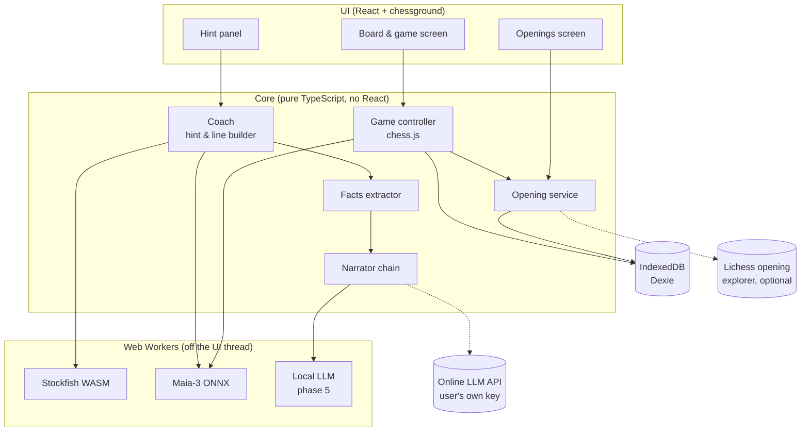
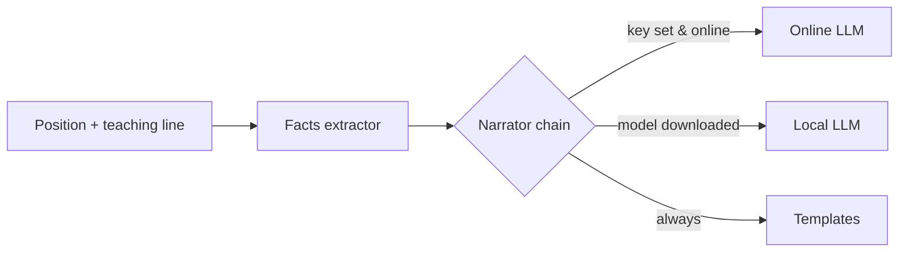

# Chess Trainer — Design Document (v1)

Status: Draft · Owner: Ben · Last updated: 2026-11-20 (after phase 1)

## 1. Goals

A training app for players rated roughly 600–1000 (chess.com) that:

1. Lets you play against **human-like** computer opponents.
2. Gives **in-game hints** that explain the *whole line*, not just the next move.
3. **Suggests openings** for beginners and **tracks** the openings and lines you play, for both colours.
4. Lets you either **explore** new openings or **deepen** ones you already play.

### Non-goals for v1

- Timed play (planned for v1.x, see §9).
- Cross-device sync, accounts, social features (v2, Rust backend, see ADR-0006).
- Importing games from chess.com / Lichess.

### Users

Ben and friends. Mostly used **on a phone**. Open source (AGPL-3.0, required by Maia-3; see ADR-0008).

## 2. High-level architecture

v1 is a **client-only Progressive Web App** (ADR-0001). There is no server of ours;
everything runs on the device. Static files are served from a free static host.



**Key rule:** the `Core` layer is plain TypeScript with no React imports. That keeps it
unit-testable, and lets a later Rust/WASM port or a backend reuse its logic and data formats.

## 3. Tech stack

| Concern | Choice | Why |
|---|---|---|
| Build | Vite + TypeScript | Fast, standard, simple config |
| UI | React | Your preference; huge ecosystem |
| Board | `chessground` | Lichess's board; mobile-friendly drag/tap, arrows, highlights |
| Rules / PGN / FEN | `chess.js` | Mature, well-tested move generator |
| State | Core objects + `useSyncExternalStore`; Zustand when needed | Phase 1: the UI subscribes directly to `GameSession`. Add Zustand once app-wide state (settings, screens) grows |
| Storage | IndexedDB via Dexie | Large structured local storage; works offline |
| Engine | Stockfish (WASM, single-threaded "lite" build first) | ADR-0002 |
| Opponent | Maia-3 via ONNX Runtime Web | ADR-0003 |
| Local LLM | WebLLM (WebGPU) with wllama (CPU) fallback | ADR-0004, phase 5 |
| PWA | `vite-plugin-pwa` | Installable on Android, offline cache |
| Tests | Vitest (unit), Playwright (end-to-end) | Standard for Vite projects |
| Hosting | Cloudflare Pages, deployed from CI, with a preview per PR (ADR-0009; replaced GitHub Pages, ADR-0007) | Free; Cloudflare adds PR preview URLs and custom headers (ADR-0002) |

## 4. Engines

### 4.1 Stockfish — the "truth"

Runs in a Web Worker and is spoken to with UCI text commands. Used **only for analysis**
(hints, explanations, mistake detection), never as the opponent.

- `MultiPV 3` so we get several candidate moves, not just one.
- Phone budget: about 1–1.5 s per hint (`go movetime`), which reaches depth ~14–18. That's
  far more than enough to find the tactics that matter at 600–1000.
- The `Engine` interface (`src/core/engine.ts`), implemented by `StockfishClient`, turns UCI
  text into typed results: `{ move, score: cp | mate, pv: Uci[], depth }[]`, scored from the side
  to move's point of view. One search at a time, queued and cancellable.
- Build: Stockfish 19 **Lite, single-threaded** (1.8 MB wasm; no cross-origin isolation needed).
  Started on first use, not at app start.

### 4.2 Maia-3 — the "human"

Maia is a neural network trained to predict **what a human of a given rating would play**.
Maia-3 is one model conditioned on rating, so strength is just an input number (`selfElo`).

Used for two things:

1. **The opponent.** Sample a move from Maia's probability distribution at the chosen
   rating (default 1100). Sampling, rather than always taking the top move, gives variety.
2. **The teaching line** (§5.2): predicting the *natural* reply a human would make.

## 5. Hints and explanations

### 5.1 Hint ladder

Each press of "Hint" reveals one more level. The game records the highest level used per move.

| Level | Shows | Example |
|---|---|---|
| 1. Nudge | What kind of moment it is | "There's a tactic here." / "Your knight is hanging." |
| 2. Piece | Highlight the piece to move | Knight on f3 glows |
| 3. Move | Arrow for the move | Nf3→e5 |
| 4. Line | The teaching line, step by step, with explanation | see §5.2 |

### 5.2 The teaching line

**Answer to "does Maia change line depth?"** Not the length: that's set by what *you* can
follow, so it stays 3–5 plies. It does change *which opponent replies we show*.

Stockfish's line shows the opponent's **best** defence. At this level the opponent usually
doesn't find it. So the line is built like this:

1. **Your move:** a Stockfish move. Among MultiPV candidates within ~30 centipawns of the best
   (or in the same win/draw/loss band), prefer the one that is most *teachable*: a clear
   motif, and a move Maia thinks a ~1200 player could plausibly find.
2. **Opponent's reply:** Maia's most likely move at the opponent's rating.
3. If Maia's reply ≠ Stockfish's best reply, **branch**:
   - "Most players reply …Qd7, and then Nxf7 wins the rook."
   - "The best defence is …Ke7, but you still win a pawn."
4. Stop after 3–5 plies, extended up to 7 only while captures or checks are still pending
   (so the line doesn't stop in the middle of an exchange).

### 5.3 Facts first, then words (ADR-0004)



The **facts extractor** is deterministic TypeScript. For each ply it outputs typed facts:

```ts
type Fact =
  | { kind: "hanging"; piece: Piece; square: Square }
  | { kind: "fork"; by: Piece; targets: Square[] }
  | { kind: "pin" | "skewer"; by: Piece; front: Square; back: Square }
  | { kind: "mateThreat"; inMoves: number }
  | { kind: "materialChange"; deltaCp: number }
  | { kind: "evalSwing"; fromCp: number; toCp: number }
  | { kind: "openingPrinciple"; rule: "develop" | "center" | "castle" | "earlyQueen" | "movingTwice" };
```

Hanging-piece detection uses Static Exchange Evaluation (SEE): count attackers and defenders
of a square and simulate the cheapest captures first.

**Narrators** all implement one interface and turn facts into text:

```ts
interface Narrator {
  id: "online" | "local" | "template";
  isAvailable(): Promise<boolean>;
  narrate(input: NarrationInput, signal: AbortSignal): Promise<string>;
}
```

The `NarratorChain` tries them in order: online → local → template. If one fails or takes
longer than ~4 s, it falls back to the next. Templates never fail, so a hint always appears.

LLM prompts carry **only** the facts plus SAN moves, and say "explain these facts for a
beginner; do not add moves or claims". That stops a model from inventing chess lines,
which is what makes a small local model usable at all.

### 5.4 Coaching while playing (phase 2b, planned)

Requested by Ben after trying phase 2 hints. In build order, since each needs the one before:

1. **Undo.** Take back moves to choose a different one. Normally a pair (your move and Maia's
   reply), so it's your turn again; repeat to go further back. While Maia is still thinking
   (or failed to move), Undo takes back only your move and cancels her reply. `hintsUsed`
   entries for undone plies are dropped. The record keeps a `takebacks` count (left out when
   zero), so a later "assisted" flag or stats can use it without changing the format. Undo is
   only offered while the game is on: a finished game's record is saved and never changes.
2. **Blunder warning** (an option, off by default). When your move loses a lot compared with
   the best one (e.g. ≥ 200 cp, a missed or allowed mate, or a newly hanging piece from the
   facts extractor), ask before it's played: "This leaves your knight on d4 undefended. Play
   it anyway?" with *Play anyway* or *Take it back*. To keep it fast, analyse the position
   in the background while it's your turn, so only the position after your move needs a short
   search (~0.3 s).
3. **"Why not?"** After a hint, you may play a different move. The app builds the teaching
   line for *your* move too (Maia's likely reply, then Stockfish), compares the two lines'
   facts and scores, and explains the difference: "After Nf3?, most players reply …Qxb5 and
   you lose the knight. Nc7+ wins the queen instead." Then you choose: **continue** with your
   move, or **go back** (undo) and play the hint's move.

## 6. Openings

### 6.1 Data

- **Names / ECO codes:** the Lichess `chess-openings` dataset (TSV, public domain). It's
  bundled with the app and turned into a lookup `positionKey → {eco, name}` at build time.
- **Beginner suggestions:** a hand-curated `beginner-openings.json` (~10 entries with
  short "why it's good for beginners" text). Example starting set:
  - White: Italian Game, London System, Scotch Game.
  - Black vs 1.e4: 1…e5 (Italian/Two Knights structures), Caro-Kann.
  - Black vs 1.d4: Queen's Gambit Declined, Slav.
- **Popularity (optional):** Lichess opening explorer API, cached in IndexedDB. If it's
  unavailable (offline, rate-limited, or needs a token) the app uses Maia probabilities
  instead. *To verify: current explorer API auth requirements.*

### 6.2 Position-keyed tree (ADR-0005)

Openings are stored as a **graph of positions**, not lists of moves, so transpositions
(the same position reached by different move orders) merge correctly.

`positionKey` = the first 4 fields of the FEN (pieces, side to move, castling, en passant),
which drops the move counters.

### 6.3 Modes, per colour

| Mode | What the opponent does in the opening | What the UI shows you |
|---|---|---|
| **Explore** | Prefers replies that lead to positions you haven't seen | Beginner suggestions you *haven't* tried |
| **Deepen** | Steers back into your chosen line(s) | Your line with "played 7×, 5 wins"; deviations flagged |

Steering works by **reweighting Maia's probabilities**, not overriding them, so the opponent
still plays plausible human moves. Only moves above a small probability floor (e.g. 5%) are
eligible, and steering stops when we leave the known tree.

**Highlighting:** any suggested opening you've already played gets a badge (games played,
score, last played). The opening tree view colours moves you've played vs not played.

### 6.4 "Your repertoire"

There's no separate setup step. A line you choose in Deepen mode becomes part of your
repertoire, and you can pin or unpin lines manually.

## 7. Data model (IndexedDB)

Designed to be **sync-ready** for v2: UUID ids, games are immutable, and all stats can be
rebuilt from games.

```ts
Game          { id: uuid, startedAt, userColor, opponent: {engine:"maia3", elo},
                startFen?, moves: uci[], pgn, result, hintsUsed: {ply, level}[],
                takebacks?, openingKey?, schemaVersion }                                     // src/core/records.ts
PositionStat  { positionKey, userColor, timesSeen, wins, draws, losses,
                lastSeenAt, children: {uci, timesPlayed}[] }        // derived, rebuildable
RepertoireLine{ id: uuid, userColor, moves: uci[], pinned: boolean, createdAt }
Settings      { opponentElo, modeWhite, modeBlack, narrator: {...}, apiKeyRef? }
```

The API key lives only on the device and is never written into exported data.

## 8. Mobile constraints

- Every heavy job (Stockfish, Maia, LLM) runs in its own **Web Worker**, so the board never freezes.
- Phase 1 uses Stockfish **single-threaded**. Multi-threading needs `SharedArrayBuffer`,
  which needs COOP/COEP headers (ADR-0002).
- Model downloads (Maia ~20 MB, local LLM ~1 GB) are cached with the Cache Storage API. The
  local LLM is **opt-in**, with a size warning and a "Wi-Fi only" default.

## 9. Delivery phases

Current status and the detailed plan for the next phase: [`docs/STATUS.md`](STATUS.md).

| Phase | Scope | Done when | Status |
|---|---|---|---|
| 0. Skeleton | Vite/React/TS, PWA, CI, lint, tests, deploy | Empty board installs on phone | ✅ Done |
| 1. Play | Board, chess.js, Maia opponent, save games | Full game vs Maia 1100 on phone | ✅ Done |
| 2. Hints | **First: move hosting to Cloudflare Pages with PR previews (ADR-0009).** Then Stockfish worker, hint ladder, teaching line, facts + templates | PRs get a working preview URL; level-4 hint explains a fork correctly | ✅ Done |
| 2b. Coaching while playing | Undo, blunder warning, "why not?" for a move other than the hint's (§5.4) | Play a different move after a hint, read why it's worse, go back and play the hint's move | |
| 3. Openings | ECO lookup, tree, stats, beginner suggestions, Explore/Deepen | Deepen mode repeats the Italian 3 games in a row | |
| 4. Online LLM | BYO-key narrator (Anthropic / OpenAI-compatible), fallback chain | Pull network → template text appears | |
| 5. Local LLM | WebLLM/wllama narrator, download UX | Works offline in airplane mode | |
| 6. Review | Post-game blunder list, eval graph | — | |
| v1.x | Timed play | — | |
| v2 | Rust backend + sync | ADR-0006 | |

## 10. Open questions

- ~~Maia-3's behaviour below 1100~~: answered by the phase 1 spike (`docs/spikes/maia-3.md`).
  It plays measurably weaker down to at least 400, so the 600–1000 range is possible in v1.
- Exact hint threshold for "teachable but slightly worse" moves: tune from real games.
- Whether hints used should affect the game record or stats (e.g. mark the game "assisted").
